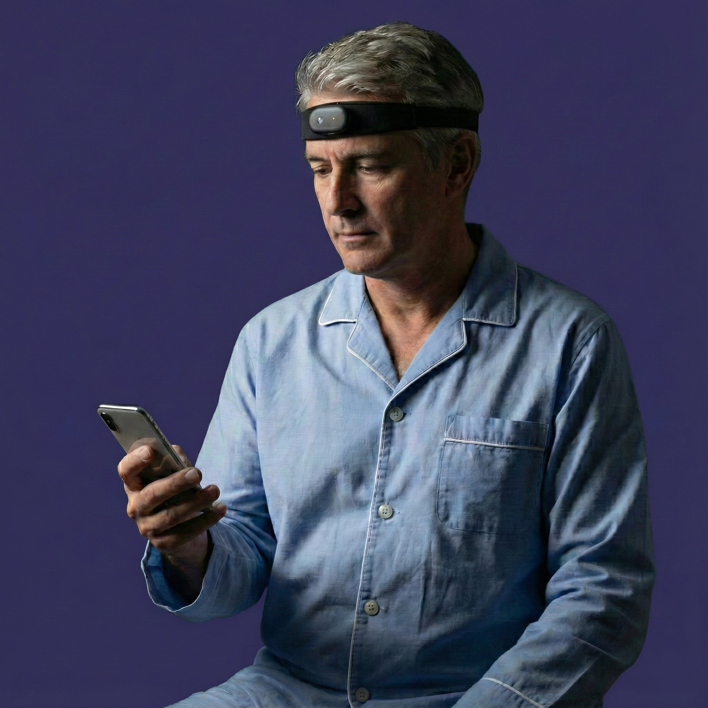
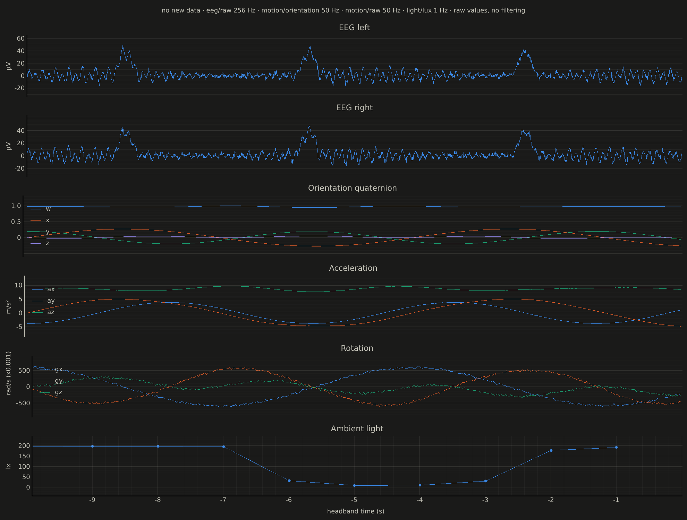

# OpenLinc demos

**Example programs built on live data from the Somnolinc sleep headband.**

Each folder here is a complete program you can run as it is, read, or use as the starting point
for your own.

**[Meet Somnolinc on Kickstarter](https://www.kickstarter.com/projects/rekonas/somnolinc-the-smart-headband-that-helps-you-sleep)** ·
[somnolinc.com](https://somnolinc.com/) · [OpenLinc](https://github.com/rekonas-com/openlinc)

<p align="center">
  <a href="https://somnolinc.com/"></a>
  <a href="openlinc_live_viewer/"></a>
</p>

## The demos

| Demo | What it does |
| --- | --- |
| [`openlinc_live_viewer`](openlinc_live_viewer/) | A page in your browser that shows EEG, acceleration, rotation and light live on one time axis, and the pebble turning as your head does. |

## What the headband delivers

| Sensor | What a program gets |
| --- | --- |
| Forehead EEG | Left and right channels in microvolts, unfiltered at 256 Hz. |
| Head movement | Orientation, acceleration and angular velocity at 50 Hz. |
| Ambient light | A reading in lux once per second. |

The headband sends this over Bluetooth to the Somnolinc Android app. The app forwards it over the
local network to the OpenLinc bridge on your computer, which you pair with the phone by scanning a
QR code. Programs on your computer receive the stream from the bridge as OSC over UDP; in Python,
`openlinc.control` reads it for you. [OpenLinc](https://github.com/rekonas-com/openlinc) has the
bridge, the Python package and the details.

## Run a demo

You'll need a Somnolinc headband, the Somnolinc Android app and a computer on the same local
network as the phone.

1. Install [uv](https://docs.astral.sh/uv/getting-started/installation/). It fetches Python and
   everything else on first use.
2. Start the demo from its folder:

   ```bash
   cd openlinc_live_viewer
   uv run main.py
   ```

3. Connect the headband in the Somnolinc app. On the **Live** screen, tap
   **Stream to PC → Scan QR code** and scan the code on your computer.

Each demo's README says what it shows and which options it takes.

## Build your own

Each demo folder is self-contained: it carries its own copy of OpenLinc, its own dependencies and
the instructions a coding agent needs (`AGENTS.md`, `CLAUDE.md` and `skills/openlinc/SKILL.md`).
Copy a demo folder, open your coding agent in it and say what you want to build. To start from an
empty folder instead, download [OpenLinc](https://github.com/rekonas-com/openlinc).

Each demo's README says which version of OpenLinc it carries.

## License

[Apache 2.0](LICENSE). Somnolinc is a product of [Rekonas](https://github.com/rekonas-com).
