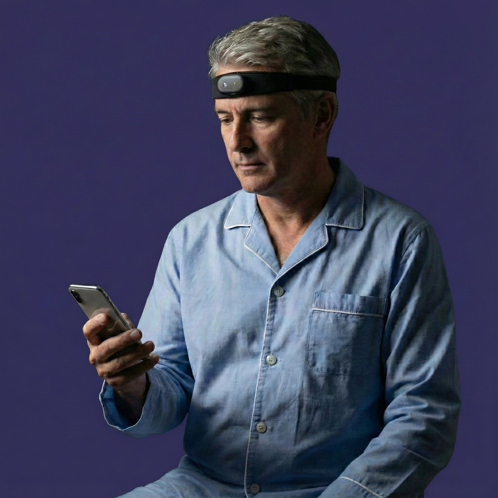
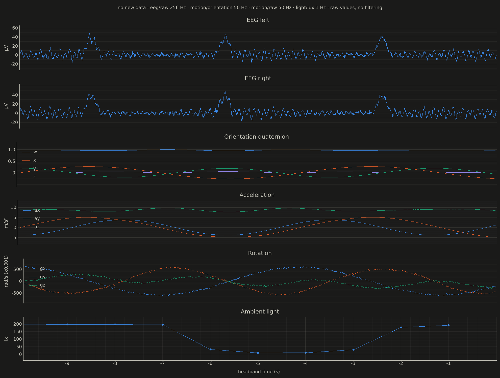

# OpenLinc live viewer

A page in your browser that shows the Somnolinc Headband's data live: EEG left and right,
acceleration, rotation and ambient light on one time axis, and the pebble turning as your head
does.

<p align="center">
  <a href="https://somnolinc.com/"></a>
  <a href="docs/openlinc-live-plot.png"></a>
</p>


## Run it

1. Install [uv](https://docs.astral.sh/uv/getting-started/installation/). It fetches Python and
   everything else on first use.
2. Start the viewer in this folder:

   ```
   uv run main.py
   ```

   If no bridge is running it starts one, which shows a QR code to scan with the Somnolinc app.
   Once the phone is linked, the live view opens in your browser. The viewer ends that bridge
   again when you end it with Ctrl+C. A bridge that was already running is left alone.

Options: `--no-browser` does not open the page, `--port` picks another port than 47110, and
`--no-bridge` leaves starting and ending the bridge to you (`uv run bridge run --if-running open`).

## What is in this folder

| | |
| --- | --- |
| `main.py` | The viewer: it reads the headband's data from the bridge and serves the page on this PC only. It uses only Python's standard library and `openlinc`. |
| `page.html` | The page: it draws the signals with uPlot and the pebble with three.js. |
| `somnolinc_pebble.glb` | The 3D model of the pebble. |
| `openlinc/` | A copy of the OpenLinc package, version 0.1.1: the bridge and the library the viewer reads the data with. |
| `skills/`, `AGENTS.md`, `CLAUDE.md` | Instructions for a coding agent that works in this folder. |

The page loads uPlot, three.js and the headline's typeface from the internet. Without a connection
the plots and the pebble are missing and the headline uses the page's own typeface.

The EEG is shown without its drift (0.5 Hz high-pass). Everything else is shown exactly as the
headband delivers it.
